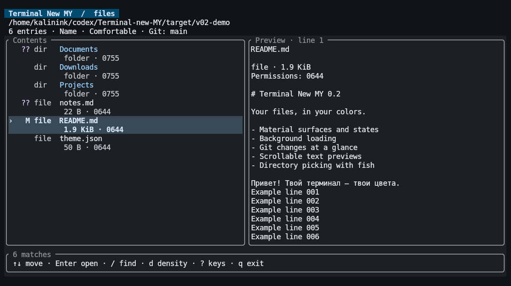
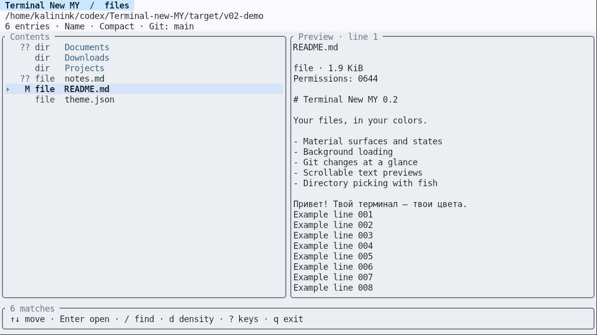
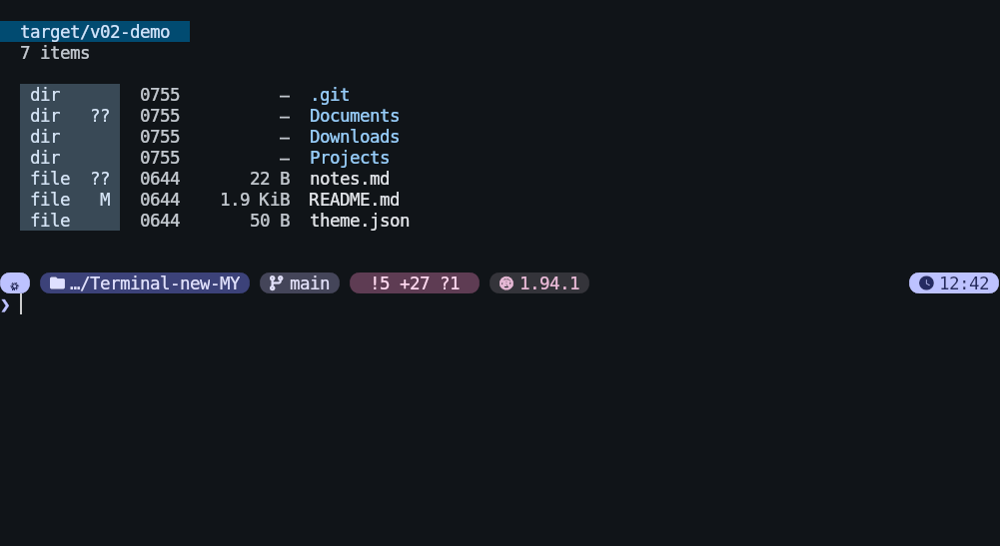

# Terminal New MY

Material You для повседневной работы в терминале: файлы, навигация и обновления
в общей палитре [Material-You-Terminal](https://github.com/Kostr2007/Material-You-Terminal).
Работает в [Kitty Material You](https://github.com/Kostr2007/Kitty-Material-You)
и обычных терминалах с UTF-8.

**v0.2 — компоненты, фоновые загрузки и удобство файлов.** Собственные нативные карточки Kitty, анимации
и полный экран событий Nix находятся в [дорожной карте](docs/roadmap.md).



<details>
<summary>Светлая тема и вывод списка</summary>




Снимки реального Kitty с базовыми Material-палитрами. Промпт на снимке списка
принадлежит существующей конфигурации fish/Starship, а не новому приложению.

</details>

## Новое в v0.2

- Общие компоненты, `compact` / `comfortable` и коррекция контраста текста.
- Загрузка каталогов и превью в фоновых задачах с отменой устаревших результатов.
- Виртуализация строк: интерфейс создаёт только видимые элементы.
- Git-статусы с кешем и ограничением времени; `--no-git` полностью отключает Git.
- Прокрутка превью, выбор пути и `mycd` для перехода в каталог из fish.
- Темы `eza`, `bat`, `fzf`, `delta` из существующей палитры `myt`.

```fish
myls --git -la
myfiles --density compact
mycd                         # c — выбрать текущий каталог, p — выделенный
mybat README.md              # после генерации тем / активации Home Manager
```

## Попробовать

```sh
nix run github:Kostr2007/Terminal-new-MY -- ls -la
nix run github:Kostr2007/Terminal-new-MY -- files
```

Или собрать локально (Rust 1.88+):

```sh
cargo build --release --locked
./target/release/tnmy ls -la
./target/release/tnmy files
./target/release/tnmy doctor
```

## Что работает

| Команда | Возможности |
| --- | --- |
| `tnmy ls [-la] [PATH…]` | Файлы и метаданные, каталоги первыми, Material-цвета |
| `tnmy ls --git` | Git-статусы файлов и изменённых каталогов |
| `tnmy ls --sort size` | Сортировка по имени, размеру или изменению |
| `tnmy ls --json` | Метаданные для программ |
| `tnmy ls --zero` | Исходные пути с NUL-разделителем |
| `tnmy files [PATH]` | Браузер, поиск, Git и прокручиваемое превью |
| `tnmy files --pick` | Выбор пути, NUL-результат в stdout |
| `tnmy files --pick-directory` | Выбор каталога для shell |
| `tnmy theme --export DIR --build-bat` | Генерация тем инструментов |
| `tnmy theme --check-contrast` | Проверка исходного и фактического контраста |
| `tnmy update` | Пересборка текущей конфигурации через `nh os switch` |
| `tnmy update --refresh` | Обновление входов flake и пересборка |
| `tnmy doctor [--json]` | Источник палитры и возможности окружения |
| `tnmy theme` | Цветовые роли текущей темы |

`tnmy ls` поддерживает собственные флаги; совместимость со всеми аргументами
GNU `ls` или `eza` не заявляется. Без цвета и при перенаправлении обычный список
содержит имена без оформления; длинные имена не обрезаются.
Для машинной обработки имён с переводами строки или не-UTF-8 байтами используйте
`--zero`. JSON требует UTF-8 путей. Не-UTF-8 имена в интерфейсе отображаются
с заменой нераспознаваемых байтов.

Браузер: **↑/↓** или **j/k** — выбор, **Enter/→** — каталог,
**←/Backspace** — родитель, **/** — поиск, **a** — скрытые файлы,
**s** — сортировка, **r** — обновление списка, темы и Git, **q/Ctrl+C** — выход.
**d** переключает плотность. **Tab** переводит стрелки на прокрутку превью,
**PageUp/PageDown** прокручивают его на страницу. **?** показывает дополнительные клавиши.
В поиске **Enter** завершает ввод, **Esc** очищает запрос.
Превью появляется при ширине от 90 колонок. Браузер требует интерактивный
stdin и stderr; обычный режим также требует stdout-терминал.
В режиме выбора интерфейс идёт в stderr, а stdout содержит только выбранный
путь с NUL. **c** выбирает текущий каталог, **p** — выделенный элемент,
**Enter** выбирает файл в `--pick` или открывает каталог. Отмена возвращает 130
и пустой stdout. Функция fish `mycd` меняет каталог родительского shell.

Файловые задачи работают независимо от UI. Отмена отбрасывает старые результаты;
системный вызов на медленной сетевой ФС может оставаться в фоне до возвращения ОС.
Git получает 600 ms на проверку корня и статусов, максимум 2 MiB результата.
Кеш хранит до 8 репозиториев на 2 секунды; `r` принудительно обновляет данные.
Распознаются staged/worktree (`XY`), `??` и агрегат `M*` для изменённых каталогов.
В `ls` Git включается явно через `--git`; в браузере его отключает `--no-git`.

## Существующая Material-тема

`tnmy` автоматически читает конфигурацию `myt`, включая `themeDir` в Nix store
или пользовательском состоянии. Если темы нет, используется встроенная тёмная.

```sh
tnmy --palette /path/to/palette.json ls
tnmy --color never files
tnmy --color always ls
tnmy --density compact files
tnmy theme --check-contrast --json
```

Переменная `TNMY_PALETTE` задаёт путь явно. Также поддерживаются `MYT_PALETTE`,
`MYT_THEME_DIR` и `MYT_CONFIG`. `NO_COLOR` отключает автоматический цвет.
В браузере тема перечитывается при **r** и resize. `TNMY_DENSITY` задаёт плотность.
Для текста проверяются реальные пары foreground/background: при контрасте ниже
4.5:1 используется читаемый запасной цвет. Исходная палитра `myt` сохраняется.

## Nix / Home Manager

Добавьте вход и импортируйте модуль в вашу конфигурацию Home Manager:

```nix
# flake.nix: inputs
terminal-new-my.url = "github:Kostr2007/Terminal-new-MY";
terminal-new-my.inputs.nixpkgs.follows = "nixpkgs";
```

```nix
# Модуль Home Manager, получающий inputs из вашей конфигурации
{ inputs, ... }: {
  imports = [ inputs.terminal-new-my.homeManagerModules.default ];
  programs.terminal-new-my.enable = true;
  # Необязательно:
  # programs.terminal-new-my.paletteFile = "/path/to/palette.json";
  # programs.terminal-new-my.replaceLs = true;
  # programs.terminal-new-my.density = "compact";
  # programs.terminal-new-my.toolThemes.enable = false;
}
```

Модуль устанавливает `tnmy`, дополнения fish и функции `myls`, `myfiles`,
`myupdate`, `mycd` и тематические обёртки. Существующие промпт, приветствие, плагины и aliases сохраняются.
`replaceLs = true` явно заменяет fish alias `ls`; поддерживаются флаги `tnmy`.
Linux x86_64 проверяется локально и в CI; aarch64 output предусмотрен,
но на ARM пока не проверен.

Без Home Manager:

```fish
source /path/to/Terminal-new-MY/integrations/fish/tnmy.fish
source /path/to/Terminal-new-MY/integrations/fish/completions/tnmy.fish
```

Бинарник `tnmy` должен быть в `PATH`.

Для отдельного пользовательского Nix-профиля и автоматического обновления тем
без пересборки системы см. [самостоятельную установку](docs/standalone-install.md).

## Общие темы инструментов

Home Manager по умолчанию генерирует темы в
`$XDG_STATE_HOME/terminal-new-my/tools`, собирает отдельный кеш bat и подключает
hook к `programs.material-you-terminal.dynamic.hooks`, если модуль `myt` импортирован.
Каждый `myt apply` обновляет темы из готового `palette.json`.
Генератор палитры и чужие конфигурационные файлы не переписываются.

Ручное подключение:

```fish
set -gx TNMY_TOOL_THEME_DIR "$HOME/.local/state/terminal-new-my/tools"
tnmy theme --export "$TNMY_TOOL_THEME_DIR" --build-bat
myeza --long
mybat README.md
printf 'one\ntwo\n' | myfzf
git diff | mydiff
```

Для автоматического обновления добавьте в существующий `myt` hook:

```sh
tnmy --palette "$MYT_PALETTE" theme --export "$HOME/.local/state/terminal-new-my/tools" --build-bat
```

`myeza`, `mybat`, `myfzf`, `mydiff` применяют тему при вызове. Существующие
настройки и aliases этих программ сохраняются. Eza учитывает унаследованный
`EZA_COLORS` / `LS_COLORS`, если он уже задан. Для `delta` генерируются цвета
строк и заголовков с `syntax-theme=none`: кеши синтаксических тем разных
версий bat/delta могут быть несовместимы. `mybat` использует собственную
синтаксическую тему и изолированный кеш. `--build-bat` требует установленный bat.

## Обновления системы

```sh
tnmy update --flake /etc/nixos --dry-run
tnmy update --flake /etc/nixos --action build
tnmy update --flake /etc/nixos --refresh
tnmy update --flake /etc/nixos -- --offline
```

При отсутствии `--flake` параметры источника берёт сам `nh` из своего окружения.
`--dry-run` печатает JSON-массив аргументов и ничего не запускает.
Текущая версия сохраняет интерфейс `nh`/`nom`, запросы привилегий и вывод
активации. Добавляются название операции, длительность и итог с кодом завершения.
Собственная визуализация событий сборки ещё не реализована.

## Разработка

```sh
nix develop
cargo fmt --check
cargo clippy --locked --all-targets -- -D warnings
cargo test --locked
cargo build --locked
python3 tools/pty-check.py target/debug/tnmy
python3 tools/integration-check.py target/debug/tnmy
nix flake check --print-build-logs
```

PTY-проверки используют стандартный Python на Unix. Они проверяют навигацию,
поиск, узкие окна, FIFO, отсутствие перерисовки в покое и восстановление терминала.
Дополнительно проверяются 10 000 файлов, выбор пути, `mycd`, Git-дедлайн,
шесть реальных палитр matugen и эталоны compact/comfortable в `tests/snapshots`.
Проверка потребителей тем требует fish/eza/bat/fzf/delta (включены в `nix develop`).
Тесты обновлений используют подставной `nh` и не меняют систему.

[Архитектура и источники](docs/architecture.md) · [План развития](docs/roadmap.md)
